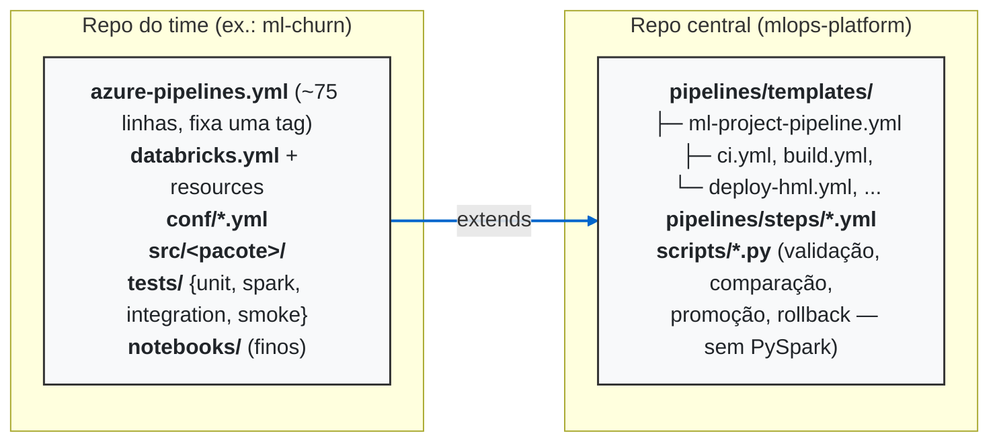

# Arquitetura da mlops-platform

## Visão geral

---

| Aspecto | **Repo do Time** (ex.: `ml-churn`) | **Repo Central** (`mlops-platform`) |
| :--- | :--- | :--- |
| **Papel Principal** | Define a **métrica de negócio e código** do projeto de ML. | Define a **padronização, segurança e infraestrutura** de CI/CD. |
| **Conteúdo Armazenado** | • Código-fonte (`src/`) • Testes (unit, spark, smoke) • Configurações do projeto (`conf/*.yml`) • Notebooks e pipelines Databricks (`databricks.yml`) | • Templates de pipeline (`ml-project-pipeline.yml`, `ci.yml`, etc.) • Steps reutilizáveis (`pipelines/steps/*.yml`) • Scripts de governança, validação e promoção (`scripts/*.py`) |
| **Arquivo de Entrada** | `azure-pipelines.yml` (enxuto, ~75 linhas no `project-template`). | `pipelines/templates/ml-project-pipeline.yml`. |
| **Como o `extends` Funciona** | Declara o uso do template apontando para o repositório central, fixa a versão do template por tag (`resources.repositories[].ref: refs/tags/vX.Y.Z`) e passa **parâmetros específicos** (ex.: `projectName`, `packageName`, `pythonVersion`). | Recebe os parâmetros fornecidos pelo repo do time e executa a sequência padronizada de *build*, validação, testes e *deploy*. |
| **Frequência de Mudança** | Constante (a cada nova iteração de modelo, experimentos ou ajustes de código). | Baixa (atualizações de versão dos templates, novos padrões de governança ou novos scripts centrais). |
| **Vantagens desse Modelo** | O cientista de dados não precisa escrever YAMLs complexos de CI/CD; foca apenas no código do modelo. | Garante conformidade e governança para toda a empresa; correções de pipeline central refletem em todos os projetos. |

O **código do modelo** (Spark, MLflow, features, EDA) vive sempre no
repositório do time. O **repositório central** nunca recebe cópias desse
código -- ele fornece apenas lógica reutilizável: templates de pipeline,
scripts de validação/governança e o `project-template` usado para começar um
projeto novo (ver `docs/onboarding.md`).

## Por que os scripts centrais não usam PySpark

`scripts/*.py` (validação de estrutura, ambiente, qualidade de dados,
métricas, comparação Champion/Challenger, promoção, verificação de metadados
e rollback) são deliberadamente escritos em Python puro + `mlflow`, sem
`pyspark`. Isso permite que rodem em qualquer agente Azure DevOps hospedado
(sem precisar de um cluster Spark local no agente) e mantém a governança
(quem pode promover, quais limites se aplicam) centralizada e auditável,
independente da linguagem/framework de modelo que cada projeto usa.

A pontuação real do modelo (que exige Spark) acontece dentro dos **jobs
Databricks do projeto** (`resources/*.job.yml`, chamando
`churn_model.cli.*`). Os scripts centrais consomem os artefatos JSON que
esses jobs produzem (`model_metrics.json`, `champion_metrics.json`,
`challenger_metrics.json`, `run_metadata.json`) -- nunca reimplementam a
lógica de scoring.

## Fluxo ponta a ponta

Ver o diagrama completo de 22 stages em `docs/release-process.md`. Resumo:

1. **CI** (`ci.yml`, `spark-tests.yml`): estrutura, lint, testes unitários e
   Spark, security scan. Roda em todo PR e merge.
2. **Build** (`build.yml`): gera o artefato imutável (wheel + `conf/` +
   `resources/` + `databricks.yml` + `commit_sha.txt` + `artifact_sha256.txt`).
3. **HML** (`deploy-hml.yml`, `data-quality.yml`, `train-candidate.yml`,
   `register-challenger.yml`, `compare-models.yml`, `model-quality-gate.yml`):
   deploy do bundle, qualidade de dados, EDA, treino do Challenger,
   comparação com o Champion no mesmo dataset de teste e quality gate.
4. **Aprovação manual** (`approval-prd.yml`): gate do Azure DevOps
   Environment `databricks-prd`; só depois disso a pipeline prossegue.
5. **PRD** (`deploy-prd.yml`, `promote-champion.yml`, `smoke-tests.yml`):
   deploy do MESMO artefato, promoção de alias (nunca re-treino, a menos que
   `retrainInProduction=true` seja explicitamente setado) e smoke test.
6. **Monitoramento**: job agendado (`monitoring.job.yml`) é (re)ativado.

## Por que aliases, e não Staging/Production

O MLflow Model Registry tradicional usa estágios (`Staging`/`Production`),
que são globais por versão e não modelam bem "qual versão está servindo
tráfego real agora" quando múltiplos ambientes compartilham um registry. A
plataforma usa exclusivamente aliases (`champion`, `challenger`,
`previous_champion`), que são a abordagem recomendada pelo MLflow moderno e
suportada pelo Unity Catalog Model Registry. Ver `docs/champion-challenger.md`.

## Registry compartilhado vs. isolado

Ver `docs/champion-challenger.md` (seção "Modos de registry") para a
diferença entre `shared_uc` (HML e PRD no mesmo metastore) e `separate_uc`
(metastores/contas isoladas, exigindo transferência de artefato com
verificação de SHA-256).
